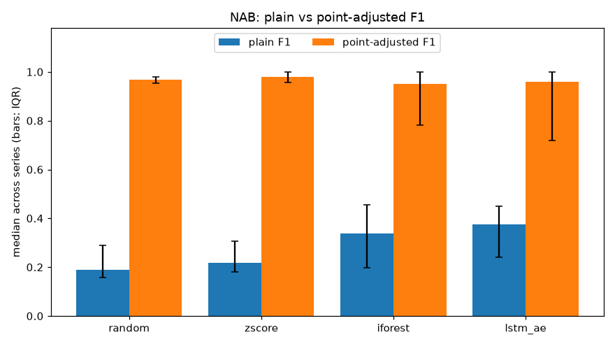

# pa-inflation

Most deep time-series anomaly detection papers report point-adjusted F1. Under point adjustment, if a detector flags any single point inside a labelled anomaly window, the whole window counts as detected. Kim et al. (AAAI 2022, "Towards a rigorous evaluation of time-series anomaly detection") showed that this makes even random scores look good. I wanted to see it for myself on public data with a few detectors I could build in a weekend.

## What I did

I took the 34 real-world NAB series from the AWS CloudWatch, known-cause and tweets folders. Four have no labelled window in their second half, which leaves 30. I trained on the first half of each series and tested on the second, since NAB has no clean train split. I also planned to run NASA SMAP/MSL, but the telemanom S3 bucket returns 403 Forbidden, so this is NAB only. The loader is still in `windows.py` if the data turns up again.

There are three detectors plus a control:

- `zscore`: rolling mean and std over the previous 100 points, score is |z|
- `iforest`: scikit-learn Isolation Forest, 100 trees, on raw 64-point windows
- `lstm_ae`: one-layer LSTM autoencoder (hidden 32) in PyTorch, one model per series, reconstruction MSE as the score, 20 epochs with early stopping on 10% of the training windows
- `random`: uniform random scores

Windows are 64 points long. They use stride 8 for training and stride 1 for scoring, and each window's score goes to its last point. Each series is min-max scaled on its training half. For every series I compute plain point-wise F1 and point-adjusted F1, each at the best of 200 quantile thresholds, plus AUROC. As a sanity line I also compute both F1s at the threshold that flags 1% of test points. The LSTM and random runs use 3 seeds, averaged within each series.

## Results

NAB, 30 series. Median across series, interquartile range in brackets.

| detector | F1 | PA-F1 | F1 @1% | PA-F1 @1% | AUROC |
|---|---|---|---|---|---|
| random | 0.188 [0.158, 0.290] | 0.969 [0.953, 0.981] | 0.017 [0.013, 0.019] | 0.914 [0.640, 0.957] | 0.500 [0.495, 0.508] |
| zscore | 0.219 [0.181, 0.306] | 0.980 [0.958, 1.000] | 0.028 [0.016, 0.037] | 0.957 [0.918, 0.969] | 0.487 [0.462, 0.547] |
| iforest | 0.338 [0.199, 0.455] | 0.951 [0.781, 1.000] | 0.082 [0.019, 0.177] | 0.729 [0.548, 0.966] | 0.614 [0.513, 0.689] |
| lstm_ae | 0.376 [0.242, 0.449] | 0.958 [0.719, 1.000] | 0.097 [0.040, 0.149] | 0.891 [0.507, 0.998] | 0.654 [0.488, 0.699] |



Point adjustment lifts everything to around 0.95, and random scores get 0.97, ahead of both the forest and the LSTM. Even at a 1% flag rate, random gets a PA-F1 of 0.91. NAB windows are long (all of a file's windows together cover about 10% of it), so a handful of random flags almost always hits each one.

I expected the gap between the LSTM AE and the z-score to shrink under plain F1. It went the other way. Under plain F1 the LSTM is clearly ahead (0.38 vs 0.22, and better on 25 of 30 series), while the z-score sits barely above random. Under PA-F1 the z-score comes out on top and the LSTM beats it on only 10 of 30. So on this data point adjustment doesn't just inflate the numbers, it reorders the detectors. The scatter in `plots/f1_vs_pa_f1_scatter.png` shows the same thing per series. The random crosses all sit in the top left corner.

Plain F1 for random is basically the score you get by flagging everything, 2p/(1+p) for anomaly rate p. Anything near 0.19 here hasn't learned much.

Per-series numbers are in `results/summary.csv`, and `notebooks/explore.ipynb` has the data and score traces.

## Running it

```
pip install -r requirements.txt
python get_data.py
python run.py
```

`python plots.py` redraws the figures from the saved results. The full run took about ten minutes on a GTX 1660 Ti, and the LSTM fits account for about four of them. For the GPU build of torch, install it from pytorch.org first.

## Limitations

- Best-threshold F1 is itself optimistic. It picks the threshold using the test labels, which no deployed detector can do. That's why the 1% flag-rate columns are there. They're much lower for everything.
- NAB has no clean training data. I used the first half of each series, and many series have labelled anomalies in that half, so the forest and the LSTM may partly learn the anomalies as normal.
- One model per series is cheap and easy to reason about, but it isn't how a production system would work. There you'd want one model across many related series, and retraining as the data drifts.
- NAB only. With the NASA data unavailable, I can't say whether the reordering holds on the spacecraft telemetry.

## Things I still want to try

- PA%K from the same paper, which only adjusts a window if at least K% of it is flagged, to see where between plain F1 and PA-F1 the ranking flips.
- Run NASA SMAP/MSL from a mirror and see whether the same thing happens there.
